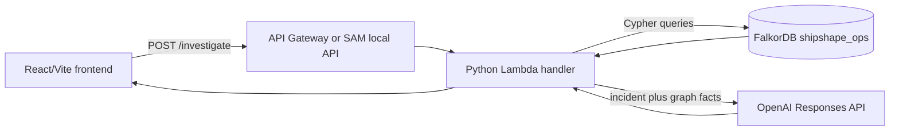

# ShipShape Graph

ShipShape Graph is a read-only DevOps incident investigation agent. A user describes an incident; the backend queries FalkorDB for connected services, dependencies, deployments, and historical incidents; OpenAI explains the retrieved evidence and proposes safe diagnostic steps.

## Problem and hackathon track

DevOps engineers often have an error message without the surrounding operational context: what service is involved, what it depends on, what changed recently, and whether a similar incident happened before. ShipShape Graph makes those connections explicit without executing commands or changing infrastructure.

The original ShipShape behavior remains available at `/troubleshoot`. The hackathon path is `/investigate`.

ShipShape Graph targets **Agents That Act on Connected Data**. It acts on connected operational data by traversing FalkorDB relationships and producing traceable diagnostic guidance. It does not automatically remediate infrastructure.

FalkorDB is essential, not decorative: `/investigate` performs real Cypher queries before the model call, and the model receives those graph facts as context. If FalkorDB is unavailable, the endpoint returns an error. If every graph result is empty, the backend returns deterministic low-confidence uncertainty and does not call OpenAI.

## Architecture



The request flow is: validate `error_text`; retrieve graph evidence; pass non-empty evidence to OpenAI; validate the structured response; display explanation, likely cause, confidence, evidence, relationships, safe diagnostics, and verification commands. The frontend never executes commands.

## Graph schema

The deterministic synthetic graph is defined in `backend/graph_schema.py` and uses graph name `shipshape_ops`.

| Label | Properties | Meaning |
|---|---|---|
| `Service` | `id`, `name`, `description`, `environment` | Application service |
| `Dependency` | `id`, `name`, `kind`, `owner_service` | Database, cache, or external dependency |
| `Deployment` | `id`, `service_id`, `version`, `deployed_at`, `status`, `change_summary` | A service change |
| `Incident` | `id`, `title`, `error_pattern`, `occurred_at`, `severity`, `status`, `root_cause`, `resolution_summary` | Historical event |

Relationships in the seed data are `DEPENDS_ON` (`Service -> Service`), `USES_DEPENDENCY` (`Service -> Dependency`), `DEPLOYED` (`Deployment -> Service`), `AFFECTS` (`Incident -> Service`), `CAUSED_BY` (`Incident -> Deployment`), and `SIMILAR_TO` (`Incident -> Incident`).

The graph is synthetic and permitted for a reproducible public demo.

## Important Cypher queries

All production investigation queries are in `backend/investigation.py`, in the `QUERIES` dictionary. Query values are parameters.

Find matching services and dependencies:

```cypher
MATCH (s:Service)-[r:DEPENDS_ON|USES_DEPENDENCY]->(target)
WHERE toLower(s.name) CONTAINS toLower($term)
   OR toLower(target.name) CONTAINS toLower($term)
RETURN s.id, s.name, type(r), target.id, target.name LIMIT 25
```

This finds both ends of a relevant relationship. The implementation retains both IDs so `Orders Service -> Payments Service` can lead to payments deployment and incident evidence.

Find recent deployments:

```cypher
MATCH (d:Deployment)-[:DEPLOYED]->(s:Service)
WHERE s.id IN $service_ids
RETURN d.id, d.version, d.deployed_at, d.status, d.change_summary, s.id
ORDER BY d.deployed_at DESC LIMIT 10
```

Find historical incidents:

```cypher
MATCH (i:Incident)-[:AFFECTS]->(s:Service)
WHERE s.id IN $service_ids
RETURN i.id, i.title, i.error_pattern, i.occurred_at, i.root_cause, s.id
ORDER BY i.occurred_at DESC LIMIT 10
```

Trace an incident to a deployment:

```cypher
MATCH p=(i:Incident)-[:AFFECTS]->(s:Service)<-[:DEPLOYED]-(d:Deployment)
WHERE i.id IN $incident_ids
RETURN i.id, s.id, d.id, d.version LIMIT 20
```

This path is the evidence trail connecting a historical incident, affected service, and deployment.

## Clean local setup

Prerequisites: Git, Python 3.12 with `venv`, Node.js 20+, Docker Compose, AWS SAM CLI, and an OpenAI API key. Local graph-backed execution does not require AWS credentials.

```bash
git clone https://github.com/Ubayed-Bin-Sufian/ShipShape.git
cd ShipShape
git switch feature/shipshape-graph
python3 -m venv .venv
source .venv/bin/activate
python -m pip install -r backend/requirements.txt
npm ci --prefix frontend
```

Start and seed FalkorDB:

```bash
docker compose -f docker-compose.falkordb.yml up -d
export FALKORDB_URL=redis://localhost:6379
.venv/bin/python -c "import sys; sys.path.insert(0, 'backend'); from graph_client import GraphClient; GraphClient.from_environment().initialize_demo_graph(); print('Graph seeded successfully')"
```

The Compose service is `falkordb`, and the Compose network for this project is `shipshape_default`. Start SAM on that network:

```bash
sam build
export OPENAI_API_KEY='your-key'
export OPENAI_MODEL='gpt-4.1-mini'
export FRONTEND_ORIGIN='http://127.0.0.1:5173'
export FALKORDB_URL='redis://falkordb:6379'
sam local start-api --host 0.0.0.0 --port 3000 --docker-network shipshape_default
```

The host-side seed process uses `redis://localhost:6379` because Compose publishes the port to the host. The SAM Lambda container uses `redis://falkordb:6379` because it reaches the database by service name on `shipshape_default`.

In a second terminal:

```bash
printf 'VITE_API_URL=http://127.0.0.1:3000\n' > frontend/.env.local
npm run dev --prefix frontend -- --host 0.0.0.0
```

Open `http://127.0.0.1:5173`. Keep this exact origin consistent with `FRONTEND_ORIGIN`; `localhost` and `127.0.0.1` are different browser origins.

## Environment variables

| Variable | Where used | Required | Secret? |
|---|---|---:|---:|
| `OPENAI_API_KEY` | Backend/Lambda | Yes for AI responses | Yes |
| `OPENAI_MODEL` | Backend/Lambda | No; defaults to `gpt-4.1-mini` | No |
| `FALKORDB_URL` | Backend/Lambda | Yes for investigation | May contain credentials; backend-only |
| `FALKORDB_GRAPH_NAME` | Backend/Lambda | No; defaults to `shipshape_ops` | No |
| `FALKORDB_CONNECT_TIMEOUT_SECONDS` | FalkorDB client | No; defaults to `2` | No |
| `FALKORDB_SOCKET_TIMEOUT_SECONDS` | FalkorDB client | No; defaults to `4` | No |
| `FRONTEND_ORIGIN` | Backend/CORS | Yes for browser calls | No |
| `VITE_API_URL` | Frontend | Yes | No; public URL |

Never put OpenAI or FalkorDB credentials in frontend variables, committed `.env` files, logs, or screenshots. `frontend/.env.local` is ignored by Git.

## API and response

`POST /investigate` accepts:

```json
{"error_text":"Payment requests time out after the payments deployment."}
```

The actual response fields are `explanation`, `likely_cause`, `diagnostic_steps`, `verification_commands`, `evidence`, `relationships`, `confidence`, and `graph_evidence`. `graph_evidence` contains `services`, `deployments`, `incidents`, and `paths` rows returned by FalkorDB.

For an empty graph result, the backend returns `confidence: "low"`, evidence saying no matching graph facts were retrieved, empty relationships, safe next steps, and does not call OpenAI.

## Demo scenarios

Known incident:

```text
Payment requests time out after the payments deployment.
```

The seeded graph should show Payments Service, deployment `payments-2.4.0`, historical payment-timeout incidents, and relationships such as Orders `DEPENDS_ON` Payments, an incident `AFFECTS` Payments, and an incident `CAUSED_BY` a deployment.

Unknown incident:

```text
Quantum toaster meltdown in an unlisted satellite subsystem
```

All graph sections should be empty. The UI should show low-confidence uncertainty, no invented service or incident, no relationships, and safe steps to check logs, deployments, configuration, and dependency health outside the seeded graph.

## Tests and verification

Commands:

```bash
.venv/bin/python -m unittest discover -s backend/tests -p 'test_*.py'
npm run build --prefix frontend
git diff --check
```

Previously verified results before this documentation-only change: backend `9 tests ... OK`; frontend Vite production build passed; `git diff --check` passed. Rerun these commands after documentation edits for the current working tree. No hosted graph-backed demo is claimed here unless separately verified.

## Security and limitations

ShipShape is read-only and never executes suggested commands. User input is size-validated, but users should remove secrets from pasted logs. The synthetic graph is small and is not a production service catalog. A local Docker database cannot be reached from deployed Lambda; a hosted deployment needs a reachable, secured FalkorDB endpoint. The local setup requires Docker, SAM CLI, an OpenAI key, and local resources for the containers.

## AI coding assistant disclosure

OpenAI Codex assisted development. The project author directed and reviewed the implementation, graph model, queries, uncertainty behavior, security constraints, and local verification. Codex did not independently verify or submit the project.

## Demo video outline (3–5 minutes)

1. Explain the incident-context problem and name the Agents That Act on Connected Data track.
2. Show FalkorDB nodes and run the service/deployment Cypher queries.
3. Submit the payment-timeout scenario and show evidence, relationships, and diagnosis.
4. Trace the incident-to-deployment path.
5. Submit the unknown scenario and show low-confidence uncertainty with no fabricated facts.
6. Close with architecture and the read-only safety model.

## Submission checklist

- Keep the public repository and `feature/shipshape-graph` branch available.
- Record and upload the demo video.
- Link the public repository and video in the submission form.
- Declare **Agents That Act on Connected Data**.
- Do not claim a hosted deployment unless verified end to end.
