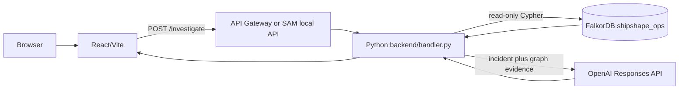
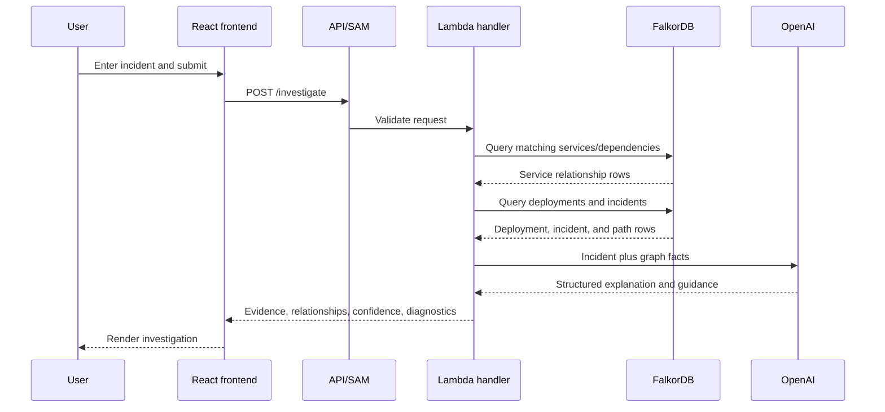
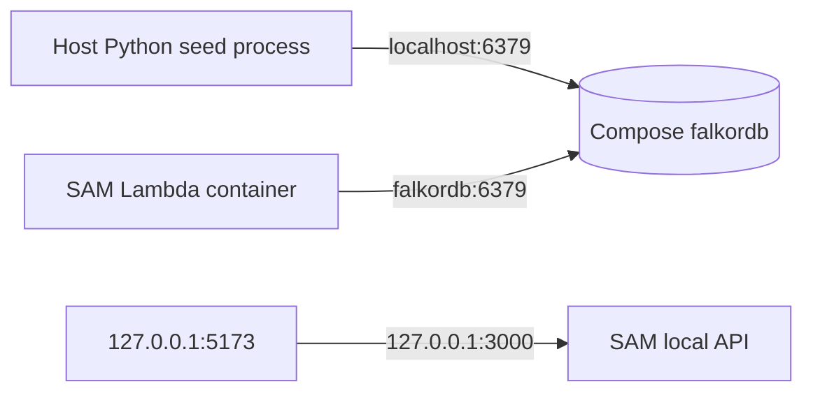

# ShipShape Graph architecture

ShipShape Graph investigates DevOps incidents using connected operational data. The original `/troubleshoot` route remains available, while the hackathon flow uses `/investigate`.

## System flow



The graph query happens before the OpenAI call. The model receives the incident text and a serialized graph-facts context. The frontend receives structured advice and evidence; it does not connect to FalkorDB directly.

## Request sequence



## Backend modules

- `backend/handler.py`: validates requests, routes `/investigate` and `/troubleshoot`, calls OpenAI for non-empty graph investigations, formats CORS/error responses, and returns the deterministic empty-evidence result.
- `backend/graph_client.py`: creates a FalkorDB client from `FALKORDB_URL`, selects the configured graph, runs read-only queries with timeouts, and seeds the demo graph.
- `backend/investigation.py`: owns term extraction, Cypher query strings, evidence retrieval, and graph context formatting.
- `backend/graph_schema.py`: owns the `shipshape_ops` name, seed Cypher, and reset query.

## Graph schema

The seed graph contains:

| Label | Properties |
|---|---|
| `Service` | `id`, `name`, `description`, `environment` |
| `Dependency` | `id`, `name`, `kind`, `owner_service` |
| `Deployment` | `id`, `service_id`, `version`, `deployed_at`, `status`, `change_summary` |
| `Incident` | `id`, `title`, `error_pattern`, `occurred_at`, `severity`, `status`, `root_cause`, `resolution_summary` |

Relationships:

- `DEPENDS_ON`: service to service.
- `USES_DEPENDENCY`: service to database/cache dependency.
- `DEPLOYED`: deployment to service.
- `AFFECTS`: incident to affected service.
- `CAUSED_BY`: incident to associated deployment.
- `SIMILAR_TO`: incident to related historical incident.

The dataset is synthetic and deterministic. It includes Web API, Orders Service, Payments Service, Auth Service, PostgreSQL, Redis, deployments, and known payment/auth incidents.

## Investigation queries

The authoritative query definitions are `backend/investigation.py:QUERIES`.

Service/dependency matching:

```cypher
MATCH (s:Service)-[r:DEPENDS_ON|USES_DEPENDENCY]->(target)
WHERE toLower(s.name) CONTAINS toLower($term)
   OR toLower(target.name) CONTAINS toLower($term)
RETURN s.id, s.name, type(r), target.id, target.name LIMIT 25
```

This returns both sides of a relationship. The implementation collects both `s.id` and `target.id`, preventing a match such as Orders-to-Payments from hiding Payments evidence.

Deployment retrieval:

```cypher
MATCH (d:Deployment)-[:DEPLOYED]->(s:Service)
WHERE s.id IN $service_ids
RETURN d.id, d.version, d.deployed_at, d.status, d.change_summary, s.id
ORDER BY d.deployed_at DESC LIMIT 10
```

Historical incident retrieval:

```cypher
MATCH (i:Incident)-[:AFFECTS]->(s:Service)
WHERE s.id IN $service_ids
RETURN i.id, i.title, i.error_pattern, i.occurred_at, i.root_cause, s.id
ORDER BY i.occurred_at DESC LIMIT 10
```

Incident/deployment path retrieval:

```cypher
MATCH p=(i:Incident)-[:AFFECTS]->(s:Service)<-[:DEPLOYED]-(d:Deployment)
WHERE i.id IN $incident_ids
RETURN i.id, s.id, d.id, d.version LIMIT 20
```

## Evidence and diagnosis behavior

For non-empty evidence, OpenAI receives:

- The original incident text.
- The graph facts under `services`, `deployments`, `incidents`, and `paths`.
- Instructions to separate facts, inferences, and hypotheses; avoid invented graph data; and use low confidence when evidence is missing or contradictory.

The frontend response fields are:

- `explanation`
- `likely_cause`
- `diagnostic_steps`
- `verification_commands`
- `evidence`
- `relationships`
- `confidence`
- `graph_evidence`

### Empty-evidence path

If all four retrieved evidence sections are empty, `handler.py` returns HTTP 200 with:

- An explanation that no matching graph facts exist.
- A likely cause stating that evidence is insufficient.
- `confidence: "low"`.
- Evidence containing `No matching graph facts were retrieved.`.
- Empty relationships.
- Safe diagnostic and verification guidance.
- The raw empty `graph_evidence` object.

OpenAI is not called in this branch, so the application cannot turn an empty graph into an invented service, deployment, or incident.

### Graph failure path

If the FalkorDB client cannot connect or a query fails, the endpoint returns HTTP 503 with a clear graph-service error. It does not fall back to mocked graph evidence.

## Local networking



`docker-compose.falkordb.yml` defines service `falkordb` and publishes port 6379. Compose creates the project network `shipshape_default`. A host process uses `redis://localhost:6379` through the published port. SAM's Lambda container must use `redis://falkordb:6379` and start with `--docker-network shipshape_default` so Docker DNS can resolve the service name.

The browser origin must exactly match `FRONTEND_ORIGIN`; `localhost:5173` and `127.0.0.1:5173` are different origins.

## Local setup summary

1. Create `.venv` and install `backend/requirements.txt`.
2. Run `docker compose -f docker-compose.falkordb.yml up -d`.
3. Seed with host-side `FALKORDB_URL=redis://localhost:6379`.
4. Run `sam build`.
5. Start SAM with `FALKORDB_URL=redis://falkordb:6379` and `--docker-network shipshape_default`.
6. Set frontend `VITE_API_URL=http://127.0.0.1:3000`.
7. Run the Vite dev server and open `http://127.0.0.1:5173`.

## Safety boundaries

OpenAI credentials and FalkorDB connection settings are backend-only. User input is validated and bounded. Suggested commands are displayed only; no command execution, automatic infrastructure change, or remediation occurs. The graph uses synthetic data for local demonstration.

## Verification

Backend tests are in `backend/tests/`. The relevant commands are:

```bash
.venv/bin/python -m unittest discover -s backend/tests -p 'test_*.py'
npm run build --prefix frontend
git diff --check
```

The empty-evidence tests verify empty query results, low confidence, explicit insufficiency, and that OpenAI is not called. The traversal tests verify service, deployment, incident, and path query sequencing.

