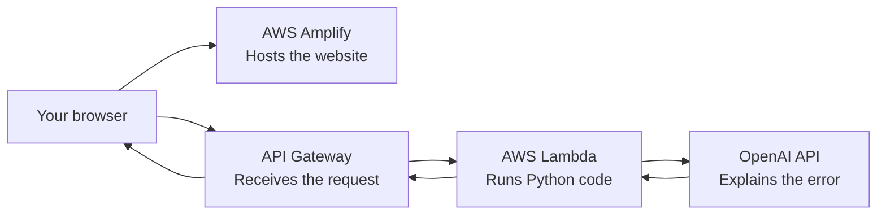
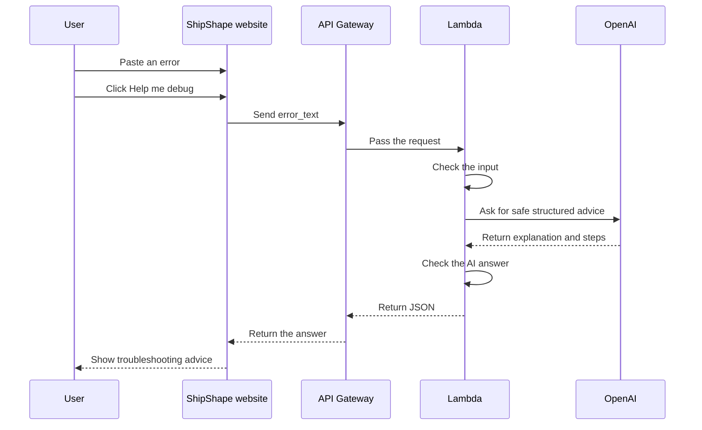
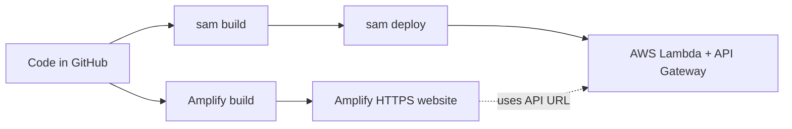

# ShipShape: Simple Architecture Guide

ShipShape is a small web application that helps people understand DevOps errors. A user pastes an error message, and ShipShape asks an AI model for safe troubleshooting suggestions.

This document explains how the pieces fit together in beginner-friendly language.

## The big picture



In simple terms:

1. Amplify shows the website.
2. The website sends an error message to API Gateway.
3. API Gateway passes the message to Lambda.
4. Lambda sends the message to OpenAI.
5. OpenAI creates troubleshooting advice.
6. Lambda sends that advice back to the website.

## What each part does

### 1. The frontend: the website users see

The frontend is inside the `frontend/` folder. It is built with React, Vite, and TypeScript.

It provides:

- A friendly introduction.
- A large box where users paste an error.
- Three example errors users can try.
- A “Help me debug” button.
- A loading message while the answer is being created.
- A clear answer divided into sections:
  - Plain-English explanation
  - Likely cause
  - Safe diagnostic steps
  - Verification commands
- Friendly messages for empty input, network problems, and server problems.
- A reminder not to paste passwords, tokens, private keys, or other secrets.

The website does not contain the OpenAI API key. It only knows the public API Gateway URL.

### 2. AWS Amplify: where the website lives

AWS Amplify Hosting stores and serves the finished frontend files. It gives the website an HTTPS address, such as:

```text
https://main.example.amplifyapp.com
```

HTTPS means the connection between the user's browser and the website is encrypted.

Amplify gets the code from GitHub. Whenever the configured branch changes, Amplify can build and publish the newest version.

The file `amplify.yml` tells Amplify how to build the website:

1. Go into the `frontend` folder.
2. Install the packages.
3. Run the production build.
4. Publish the `frontend/dist` folder.

### 3. API Gateway: the front door for the backend

Amazon API Gateway gives Lambda a public HTTPS address. The frontend sends requests to:

```text
POST /troubleshoot
```

The word `POST` means the browser is sending information to the server.

The request looks like this:

```json
{
  "error_text": "docker: permission denied while trying to connect to the Docker daemon socket"
}
```

API Gateway passes this request to Lambda. It also helps handle browser security rules called CORS. CORS tells the backend which website is allowed to call it.

### 4. AWS Lambda: the Python backend

Lambda runs the Python code in `backend/handler.py`. There is no server to manage or keep running. AWS starts the function when a request arrives and stops it when the work is finished.

Lambda does the following:

1. Checks whether the request is valid JSON.
2. Checks that `error_text` exists and is not empty.
3. Rejects messages longer than 12,000 characters.
4. Sends the error to OpenAI.
5. Checks that the AI answer has the expected sections.
6. Sends the answer back to the browser.

Lambda does not run commands from the AI answer. It does not log in to servers, change AWS resources, or modify the user's computer.

### 5. OpenAI: the AI service

Lambda uses the official OpenAI Python package and the Responses API. The AI receives:

- A safety instruction.
- The user's error text.
- A required answer format.

The AI must return these four sections:

```json
{
  "explanation": "What the error means",
  "likely_cause": "What probably caused it",
  "diagnostic_steps": ["Safe things to check"],
  "verification_commands": ["Commands the user can review"]
}
```

The commands are only displayed on the screen. ShipShape never runs them automatically.

## How one request works



## What the user experiences

### Before sending

The user sees the introduction and can either paste an error or click an example prompt.

### While sending

The button changes to a loading state. This tells the user that the request is being processed.

### After a successful answer

The answer appears in four parts:

1. **In plain English** — a simple explanation.
2. **Likely cause** — the most probable reason.
3. **Safe diagnostic steps** — things to check before changing anything.
4. **Verify the fix** — commands the user can review and run manually.

### If something goes wrong

- Empty input is handled in the browser.
- Invalid input receives a `400` response.
- A busy OpenAI service receives a `429` response.
- A temporary provider problem receives a `502` response.
- Unexpected server problems receive a general `500` response.
- The website shows a readable message and offers retry behavior where appropriate.

## Keeping secrets safe

There are two different types of information in this application:

### Safe to put in the frontend

```text
VITE_API_URL
```

This is just the public address of API Gateway. It is not a password.

### Must stay in the backend

```text
OPENAI_API_KEY
```

This is a private key. It must never be placed in React code, a `VITE_*` variable, GitHub source code, or a committed `.env` file.

For a small demo, the key is configured on Lambda during deployment. For a more serious production application, store it in AWS Secrets Manager and allow only Lambda to read it.

Users should also remove secrets from error logs before pasting them into ShipShape. Examples include:

- Passwords
- AWS access keys
- OpenAI keys
- GitHub tokens
- Private SSH keys
- Database connection strings

## How the AWS resources are created

The file `template.yaml` is an AWS SAM template. SAM is a simpler way to describe serverless AWS resources.

The template creates:

- One Lambda function.
- One API Gateway HTTP API.
- A connection between the API and Lambda.
- Environment settings for Lambda.

The basic deployment process is:



## Beginner deployment checklist

1. Make sure the backend tests pass:

   ```bash
   python3 -m unittest discover -s backend/tests -p 'test_*.py'
   ```

2. Build the frontend:

   ```bash
   cd frontend
   npm run build
   ```

3. Build the AWS package:

   ```bash
   cd ..
   sam build
   ```

4. Deploy the backend:

   ```bash
   sam deploy --guided
   ```

5. Copy the API URL printed by SAM.
6. Add that URL to Amplify as `VITE_API_URL`.
7. Deploy the frontend through Amplify.
8. Copy the Amplify HTTPS URL.
9. Update Lambda's `FrontendOrigin` to the exact Amplify URL.
10. Test the application from the Amplify URL.

## What happens when the user clicks the button

The full process is:

```text
User clicks the button
        ↓
React sends POST /troubleshoot
        ↓
API Gateway receives the request
        ↓
Lambda checks the request
        ↓
Lambda asks OpenAI for structured advice
        ↓
Lambda checks the answer
        ↓
API Gateway sends the answer back
        ↓
React displays the four answer sections
```

The important safety idea is that ShipShape is an advisor, not an automation tool. It explains what a user may want to check, but the user remains in control of every command and infrastructure change.

